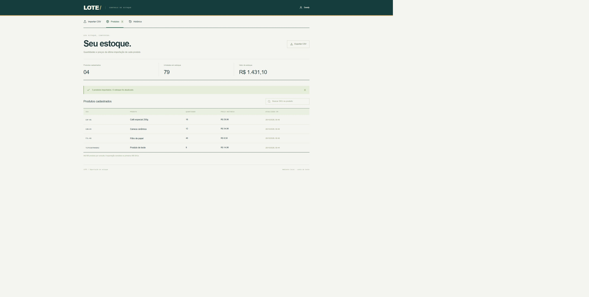

# Lote — Importador de estoque

Aplicação para importar um estoque por CSV, conferir erros por linha e gravar o lote inteiro de forma atômica. Cada usuário tem seu próprio estoque e histórico. Reenviar o mesmo conteúdo não duplica produtos nem cria outra importação.

## Demonstração no GitHub Pages

[Abrir demonstração interativa](https://mateusmarques2026.github.io/importador-estoque/)

A demonstração usa as mesmas interfaces do projeto com um adaptador exclusivo em demo/. Os dados são fictícios, ficam no armazenamento local do navegador e podem ser reiniciados pelo botão no topo. A troca de visão simula os papéis para apresentação; não é autenticação nem controle de acesso real. Não use dados pessoais nesta demonstração. A versão completa com servidor, identidade e SQL permanece no restante do projeto.

Para executar: npm ci, npm run demo:build e npm run demo:dev. O comando demo:build gera dist-demo/; o workflow pages.yml publica essa pasta. Em Settings → Pages, a origem é GitHub Actions.

## O problema

Planilhas chegam com formatos diferentes, SKUs repetidos e valores inválidos. Gravar parte do arquivo deixa o estoque inconsistente; reenviar o mesmo lote pode duplicar dados. O projeto valida antes de confirmar e repete a validação no servidor durante a importação.

## Funcionalidades

- Arquivo CSV por seleção, arrastar/soltar ou texto colado.
- Prévia com indicação de produto novo, atualização e erro por linha.
- Vírgula/ponto e vírgula, BOM, CRLF, aspas escapadas e campos multilinha.
- Preços brasileiros e decimais normalizados em centavos inteiros.
- Importação integral: havendo erro, nenhum registro é gravado.
- SKU identifica o produto. Reimportar uma correção atualiza o saldo final.
- SHA-256 do conteúdo normalizado e restrição única para idempotência, inclusive em solicitações simultâneas.
- Estoque pesquisável, resumo e histórico dos lotes confirmados.
- Exportação de CSV com neutralização de fórmulas em campos de texto.
- Dados isolados pelo ID autenticado no servidor.

## Executar

Requisitos: Node.js 24, npm e Git. Não exige conta Cloudflare para rodar o banco local.

~~~sh
npm ci
npm run build
npm run db:migrate:local
npm run dev -- --port 5175
~~~

Abra http://localhost:5175 e clique em entrar. Localmente, a identidade é uma conta fictícia. A versão hospedada usa a identidade gerenciada pelo Sites e começa privada. Não há autenticação própria por senha.

## Formato

~~~csv
sku;nome;quantidade;preco
CAF-01;Café especial 250g;18;29,90
FIL-02;Filtro de papel;40;8,50
~~~

A ordem das quatro colunas pode variar. Também aceita aliases como código, produto, qtd e valor. SKU tem de 2 a 32 caracteres, normalizado para maiúsculas; quantidade é inteira entre 0 e 1.000.000; preço fica entre zero e R$ 100.000 com até duas casas decimais. Arquivos UTF-8 de até 200 KB e 200 produtos.

## Testar

~~~sh
npm test
npm run typecheck
npm run build
~~~

Para integração, abra npm run dev:roles -- --port 5175 em outro terminal e execute npm run test:integration. LOTE_TEST_URL pode selecionar outra URL de loopback.

O modo dev:roles habilita perfis locais de teste via x-studio-test-user, depois do login local. É desativado no desenvolvimento normal e não entra no Worker de produção. Os testes escrevem produtos fictícios em um banco local separado da produção.

## Decisões técnicas

O servidor faz o parse do CSV novamente ao confirmar, sem confiar na prévia ou em linhas enviadas pelo navegador. Produtos válidos são ordenados por SKU e serializados em um formato determinístico. SHA-256 desse conteúdo identifica o lote, independentemente da ordem das linhas, do separador ou da formatação monetária equivalente.

A chave de products é usuário + SKU. Um índice único em imports é usuário + hash. O registro do lote e os upserts dos produtos são executados em um único batch atômico D1. Os produtos são agrupados em statements de até 12 linhas para manter cada statement abaixo de 100 parâmetros. Se duas importações iguais disputarem o índice, uma confirma e a outra retorna o lote existente.

O saldo importado é absoluto: 10 significa que existem 10 unidades, sem somar ao saldo anterior. Isso permite corrigir e reenviar a planilha de forma previsível.

## Estrutura

~~~text
app/inventory.tsx          Envio, prévia, estoque e histórico
app/api/[...path]/route.ts API autenticada
lib/csv.ts                Parser, validação, normalização e exportação
lib/inventory.ts          D1, hash e transação de importação
db/schema.ts              Produtos e lotes
drizzle/                  Migração SQL
tests/                    Parser e integração HTTP
~~~

## Endpoints

| Método | Rota | Ação |
| --- | --- | --- |
| POST | /api/preview | Validar sem gravar |
| POST | /api/imports | Confirmar lote completo |
| GET | /api/products?q= | Estoque da conta e resumo |
| GET | /api/imports | Últimos 50 lotes da conta |
| GET | /api/export | CSV do estoque |

## Tecnologias e limites

React, TypeScript, Vinext/Vite, Workers, D1/SQLite, Drizzle e Zod, a partir do starter do Sites. O banco local fica em .wrangler/state. O estoque pesquisável e a exportação retornam até 500 produtos. Não inclui processamento em segundo plano ou edição manual de produtos; paginação e importações maiores são próximos incrementos.

O código teve assistência de IA. Para uma entrevista, pratique explicar idempotência, transação, validação no servidor e o motivo de usar centavos inteiros.
